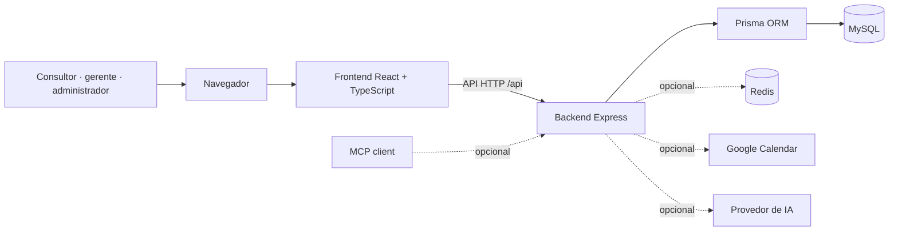

# Time Tracker

[](https://github.com/M4ster3001/time-tracker/actions/workflows/ci.yml)

## Registro de horas simples de entender, útil para pessoas e equipes

O **Time Tracker** é uma aplicação open source para registrar trabalho, organizar horas por cliente e projeto, acompanhar saldos e transformar apontamentos em relatórios. Foi pensado para profissionais independentes, consultorias, agências e empresas de serviços que precisam de uma visão consistente do trabalho realizado — sem começar com uma planilha espalhada por cada equipe.

**MIT · React · Node.js · TypeScript · MySQL**

[Começar a usar](docs/getting-started/installation.md) · [Personalizar](docs/getting-started/customization.md) · [Índice da documentação](docs/README.md) · [Contribuir](CONTRIBUTING.md)

[Instruções para agentes](AGENTS.md) · [Saúde do repositório](docs/operations/repository-health.md)

---

## Para quem é

| Perfil | Como pode ajudar |
| --- | --- |
| Profissional independente | Registrar horas, revisar o próprio histórico e exportar dados para acompanhamento. |
| Pequenas equipes e consultorias | Associar trabalho a clientes e projetos, acompanhar alocações e dar visibilidade a gestores. |
| Empresas de serviços | Separar responsabilidades por perfil, revisar períodos, acompanhar saldos e padronizar relatórios. |

Os fluxos e permissões variam conforme a configuração do sistema. Antes de usar com dados reais, cada organização deve revisar suas regras, políticas de acesso, retenção e obrigações legais.

## O que já existe

- Lançamentos manuais, apontamento rápido e timer de acompanhamento.
- Organização por cliente, projeto, equipe e alocação de horas.
- Perfis de administrador, gerente e consultor, com permissões e fluxos configuráveis.
- Painéis, saldos, fechamento de períodos, histórico e exportações.
- Tema claro/escuro, interface em português e inglês e layouts responsivos.
- Integrações opcionais com Google Calendar, provedores de IA e clientes MCP. Cada uma exige configuração e revisão próprias; veja [Integrações](docs/integrations/README.md).

> Esta distribuição cobre o aplicativo web e a API; não acompanha um pacote Electron/desktop completo.

## Visão da arquitetura



Mais contexto: [arquitetura](docs/development/architecture.md) e [diagramas editáveis](docs/diagrams/README.md).

## Comece em poucos passos

Para uma execução local com Docker Compose:

```bash
cp .env.example .env
cp backend/.env.example backend/.env
cp backend/.env.docker.example backend/.env.docker
# Edite os três arquivos e troque os valores de exemplo por valores locais.
docker compose up --build -d
```

Abra `http://localhost:3000`. O primeiro acesso segue o fluxo de configuração inicial disponível na aplicação. Para desenvolvimento com Node.js, migrações e seed de demonstração, siga o [guia de instalação](docs/getting-started/installation.md); **não use os valores de exemplo em produção**.

## Personalize para o seu contexto

O nome, tagline, cores, ícone e textos da interface podem ser ajustados sem manter uma identidade de terceiros. Comece pelo [guia de personalização](docs/getting-started/customization.md). Para alterar integrações, papéis, regras ou implantação, use o [índice da documentação](docs/README.md).

## Tecnologias e organização

Este projeto é distribuído como repositório/código-fonte. O workspace raiz permanece marcado como privado no npm para evitar uma publicação acidental do monorepo como pacote.

```text
backend/       API Express, regras de domínio, autenticação, integrações e Prisma
frontend/      SPA React, componentes, páginas, temas e testes
scripts/       checagens de distribuição e utilitários de assets
 docs/         guias por assunto, referências e diagramas
```

Os módulos de backend ficam em `backend/src/modules/`; as páginas e componentes de interface ficam em `frontend/src/`. Veja [como navegar no código](docs/development/README.md).

## Qualidade e segurança

```bash
npm ci
npm audit --audit-level=high
npm run lint:ci
npm run type-check
npm run test
npm run build
npm run release:check
```

O projeto inclui controles defensivos, mas **não é uma certificação de segurança nem uma garantia de adequação regulatória**. Antes de operar em uma organização, configure segredos únicos, HTTPS, backup e restauração testados, monitoramento, gestão de acesso e revisão de privacidade. A configuração local de Compose é voltada a desenvolvimento.

## Licença

O código deste projeto é distribuído sob a licença [MIT](LICENSE). Bibliotecas, fontes e outros componentes de terceiros continuam sujeitos às respectivas licenças; consulte [THIRD_PARTY_NOTICES.md](THIRD_PARTY_NOTICES.md) e revise o artefato final antes de redistribuí-lo.
