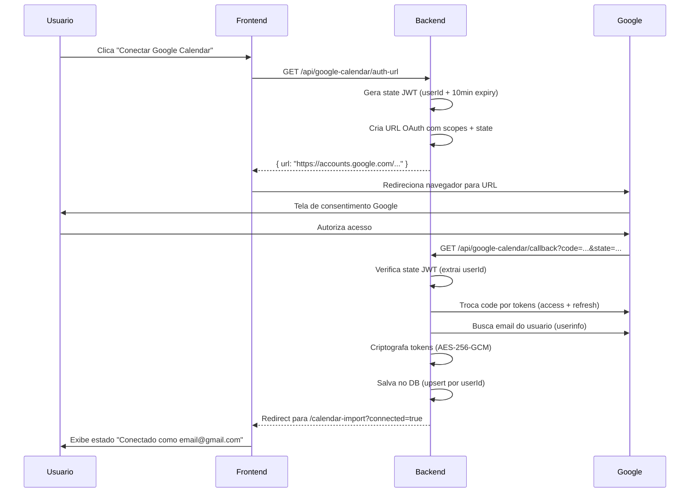
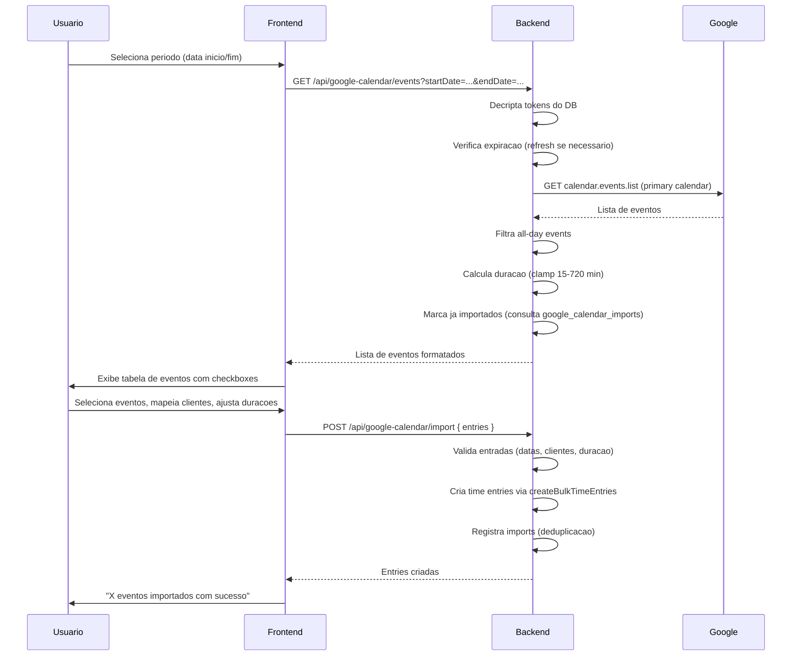
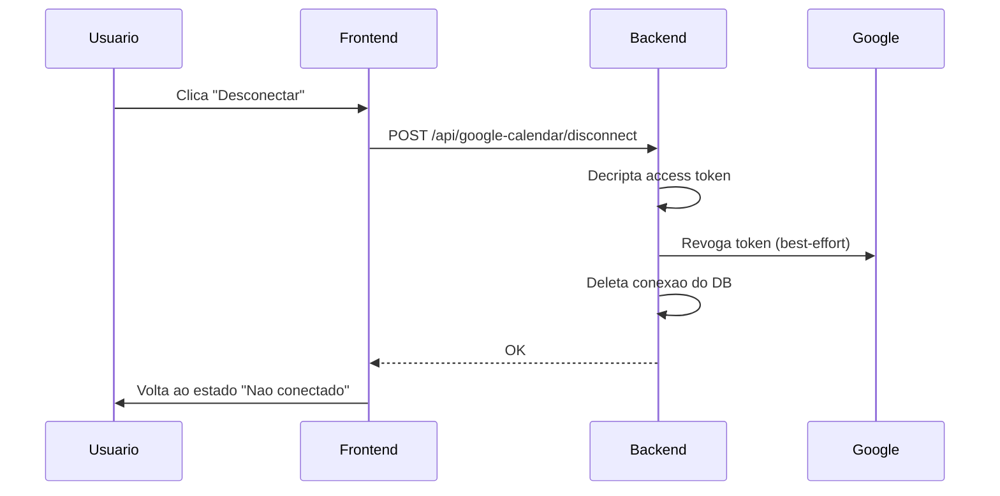

# Integracao Google Calendar - Time Tracker System

## Indice

1. [Visao Geral](#1-visao-geral)
2. [Por que usar](#2-por-que-usar)
3. [Pre-requisitos e Configuracao](#3-pre-requisitos-e-configuracao)
4. [Variaveis de Ambiente](#4-variaveis-de-ambiente)
5. [Fluxo Completo](#5-fluxo-completo)
6. [Endpoints da API](#6-endpoints-da-api)
7. [Modelo de Dados](#7-modelo-de-dados)
8. [Seguranca](#8-seguranca)
9. [Guia de Uso (Frontend)](#9-guia-de-uso-frontend)
10. [Solucao de Problemas](#10-solucao-de-problemas)

---

## 1. Visao Geral

A integracao com o Google Calendar permite que **consultores** (roleId=3) e **managers** (roleId=2) importem eventos do seu calendario Google diretamente como lancamentos de horas no sistema.

O sistema utiliza OAuth 2.0 para conectar a conta Google do usuario, busca eventos de um periodo selecionado e permite que o usuario escolha quais eventos importar, associando cada um a um cliente e ajustando a duracao se necessario.

**Funcionalidades:**
- Conexao segura via OAuth 2.0 (escopo somente leitura)
- Busca de eventos por periodo (ate 31 dias)
- Selecao individual de quais eventos importar
- Edicao da descricao e duracao antes de importar
- Mapeamento de cada evento para um cliente
- Deduplicacao automatica (eventos ja importados sao marcados)
- Desconexao a qualquer momento (revogacao de tokens)

---

## 2. Por que usar

### Beneficios

| Beneficio | Descricao |
|-----------|-----------|
| **Produtividade** | Elimina digitacao manual de reunioes e compromissos ja registrados no calendario |
| **Precisao** | Duracao calculada automaticamente a partir dos horarios reais do evento |
| **Agilidade** | Importacao em lote de multiplos eventos de uma vez |
| **Sem duplicatas** | Sistema rastreia eventos ja importados, impossibilitando lancamentos duplicados |
| **Seguranca** | Tokens Google criptografados com AES-256-GCM, acesso somente leitura ao calendario |
| **Controle** | Usuario escolhe individualmente quais eventos importar e para qual cliente |

### Cenario de Uso Tipico

1. Consultor tem 8 reunioes no dia, todas registradas no Google Calendar
2. Ao inves de lancar 8 entradas manualmente, acessa "Google Calendar" no menu
3. Busca eventos do dia, seleciona as reunioes relevantes
4. Associa cada reuniao ao cliente correto, ajusta duracoes se necessario
5. Importa tudo de uma vez - 8 lancamentos criados em segundos

---

## 3. Pre-requisitos e Configuracao

### 3.1 Criar Projeto no Google Cloud

1. Acesse o [Google Cloud Console](https://console.cloud.google.com/)
2. Crie um novo projeto ou selecione um existente
3. No menu lateral, va em **APIs e Servicos > Biblioteca**
4. Busque e habilite a **Google Calendar API**

### 3.2 Configurar Tela de Consentimento OAuth

1. Va em **APIs e Servicos > Tela de consentimento OAuth**
2. Selecione **Externo** (ou Interno se for Google Workspace)
3. Preencha os campos obrigatorios:
   - Nome do aplicativo: `Time Tracker` (ou o nome desejado)
   - Email de suporte
   - Dominios autorizados (se aplicavel)
4. Em **Escopos**, adicione:
   - `https://www.googleapis.com/auth/calendar.events.readonly`
   - `https://www.googleapis.com/auth/userinfo.email`
5. Em **Usuarios de teste**, adicione os emails dos usuarios (enquanto o app estiver em modo de teste)

> **Nota:** Enquanto o app estiver em modo "Teste", somente usuarios listados na tela de consentimento conseguirao conectar. Para uso em producao, sera necessario submeter para verificacao do Google.

### 3.3 Criar Credenciais OAuth 2.0

1. Va em **APIs e Servicos > Credenciais**
2. Clique **Criar credenciais > ID do cliente OAuth**
3. Tipo de aplicativo: **Aplicativo da Web**
4. Nome: `Time Tracker Backend`
5. **URIs de redirecionamento autorizados**:
   - Desenvolvimento: `http://localhost:5000/api/google-calendar/callback`
   - Producao: `https://seu-dominio.com/api/google-calendar/callback`
6. Clique **Criar**
7. Anote o **Client ID** e **Client Secret**

### 3.4 Configurar Variaveis de Ambiente

Adicione ao arquivo `.env` do backend:

```env
GOOGLE_CLIENT_ID=seu-client-id.apps.googleusercontent.com
GOOGLE_CLIENT_SECRET=seu-client-secret
GOOGLE_REDIRECT_URI=http://localhost:5000/api/google-calendar/callback
```

### 3.5 Executar Migration

Se ainda nao executou a migration que cria as tabelas:

```bash
cd backend
npx prisma migrate dev
```

Isso cria as tabelas `google_calendar_connections` e `google_calendar_imports`.

---

## 4. Variaveis de Ambiente

| Variavel | Obrigatoria | Padrao | Descricao |
|----------|-------------|--------|-----------|
| `GOOGLE_CLIENT_ID` | Sim* | `''` | Client ID do OAuth 2.0 do Google Cloud |
| `GOOGLE_CLIENT_SECRET` | Sim* | `''` | Client Secret do OAuth 2.0 |
| `GOOGLE_REDIRECT_URI` | Nao | `http://localhost:5000/api/google-calendar/callback` | URI de callback OAuth |

> *A integracao e **opcional**. Se as variaveis nao forem definidas, o sistema funciona normalmente sem a funcionalidade de Google Calendar. Ao tentar usar, o usuario recebera a mensagem "Google Calendar integration is not configured".

---

## 5. Fluxo Completo

### 5.1 Fluxo de Conexao (OAuth)



### 5.2 Fluxo de Importacao



### 5.3 Fluxo de Desconexao



---

## 6. Endpoints da API

### GET /api/google-calendar/auth-url

Gera a URL de autorizacao OAuth do Google.

**Auth:** Bearer token (consultor ou manager)

**Response 200:**
```json
{
  "success": true,
  "data": {
    "url": "https://accounts.google.com/o/oauth2/v2/auth?..."
  }
}
```

**Erro 500:** Se `GOOGLE_CLIENT_ID` ou `GOOGLE_CLIENT_SECRET` nao estao configurados.

---

### GET /api/google-calendar/callback

Callback OAuth chamado pelo Google apos autorizacao. Nao requer autenticacao (o userId esta no parametro `state` assinado por JWT).

**Query params:**
- `code` - Codigo de autorizacao do Google
- `state` - JWT assinado contendo `userId`

**Comportamento:**
- Sucesso: redireciona para `{CORS_ORIGIN}/calendar-import?connected=true`
- Erro: redireciona para `{CORS_ORIGIN}/calendar-import?error=auth_failed`
- Params ausentes: redireciona para `{CORS_ORIGIN}/calendar-import?error=missing_params`

---

### GET /api/google-calendar/status

Retorna o status da conexao do usuario.

**Auth:** Bearer token

**Response 200 (conectado):**
```json
{
  "success": true,
  "data": {
    "connected": true,
    "id": 1,
    "userId": 5,
    "calendarEmail": "usuario@gmail.com",
    "tokenExpiresAt": "2026-02-03T15:30:00.000Z",
    "createdAt": "2026-02-01T10:00:00.000Z",
    "updatedAt": "2026-02-03T14:30:00.000Z"
  }
}
```

**Response 200 (nao conectado):**
```json
{
  "success": true,
  "data": {
    "connected": false
  }
}
```

> **Nota:** Tokens criptografados nunca sao expostos na resposta.

---

### POST /api/google-calendar/disconnect

Desconecta a conta Google do usuario.

**Auth:** Bearer token

**Comportamento:**
1. Busca conexao do usuario
2. Decripta access token
3. Tenta revogar token no Google (best-effort, falha silenciosa)
4. Deleta registro da conexao no banco
5. Se nao havia conexao, retorna sucesso silenciosamente

**Response 200:**
```json
{
  "success": true,
  "message": "Disconnected"
}
```

---

### GET /api/google-calendar/events

Busca eventos do Google Calendar do usuario para um periodo.

**Auth:** Bearer token

**Query params:**
- `startDate` - Data inicio no formato `YYYY-MM-DD`
- `endDate` - Data fim no formato `YYYY-MM-DD`

**Validacoes:**
- Ambas as datas sao obrigatorias
- Formato de data valido
- Intervalo maximo de 31 dias
- `endDate >= startDate`

**Response 200:**
```json
{
  "success": true,
  "data": [
    {
      "googleEventId": "abc123",
      "summary": "Reuniao com cliente",
      "startDateTime": "2026-02-03T09:00:00-03:00",
      "endDateTime": "2026-02-03T10:00:00-03:00",
      "date": "2026-02-03",
      "durationMinutes": 60,
      "alreadyImported": false
    },
    {
      "googleEventId": "def456",
      "summary": "Daily standup",
      "startDateTime": "2026-02-03T10:00:00-03:00",
      "endDateTime": "2026-02-03T10:15:00-03:00",
      "date": "2026-02-03",
      "durationMinutes": 15,
      "alreadyImported": true
    }
  ]
}
```

**Regras de negocio:**
- Eventos de dia inteiro (all-day) sao **filtrados** automaticamente
- Duracao minima: 15 minutos (eventos mais curtos sao arredondados para 15)
- Duracao maxima: 720 minutos (12 horas)
- Campo `alreadyImported` indica se o evento ja foi importado anteriormente
- Busca somente no calendario primario do usuario
- Maximo de 250 eventos por consulta

---

### POST /api/google-calendar/import

Importa eventos selecionados como lancamentos de horas.

**Auth:** Bearer token

**Request body:**
```json
{
  "entries": [
    {
      "googleEventId": "abc123",
      "clientId": 1,
      "date": "2026-02-03",
      "activityDescription": "Reuniao com cliente",
      "durationMinutes": 60
    }
  ]
}
```

**Validacoes:**
- `entries` e obrigatorio e deve ser um array nao vazio
- Maximo de 100 entradas por importacao
- Cada entrada deve ter `date` valido, `clientId`, `activityDescription` e `durationMinutes`
- As mesmas validacoes de `createBulkTimeEntries` se aplicam (lockDay, duracao, acesso ao cliente)

**Response 201:**
```json
{
  "success": true,
  "data": [
    {
      "id": 42,
      "userId": 5,
      "clientId": 1,
      "date": "2026-02-03T00:00:00.000Z",
      "activityDescription": "Reuniao com cliente",
      "durationMinutes": 60,
      "createdAt": "2026-02-03T14:30:00.000Z",
      "updatedAt": "2026-02-03T14:30:00.000Z"
    }
  ]
}
```

**Comportamento interno:**
1. Normaliza as entradas (parse de datas, conversao de tipos)
2. Chama `createBulkTimeEntries` (mesmo servico do lancamento em lote)
3. Registra na tabela `google_calendar_imports` o mapeamento `googleEventId -> timeEntryId`
4. A deduplicacao usa constraint `UNIQUE(userId, googleEventId)` com `skipDuplicates`

---

## 7. Modelo de Dados

### GoogleCalendarConnection

Armazena a conexao OAuth do usuario com o Google.

| Coluna | Tipo | Descricao |
|--------|------|-----------|
| id | INT (PK) | Identificador auto-incremento |
| userId | INT (UNIQUE) | FK para User. Um usuario = uma conexao |
| accessTokenEnc | TEXT | Access token criptografado (AES-256-GCM) |
| refreshTokenEnc | TEXT | Refresh token criptografado (AES-256-GCM) |
| tokenExpiresAt | DATETIME | Validade do access token |
| calendarEmail | VARCHAR? | Email da conta Google conectada |
| createdAt | DATETIME | Data de criacao |
| updatedAt | DATETIME | Data de atualizacao |

**Relacoes:** `User (1) -> (0..1) GoogleCalendarConnection`

**Cascade:** Ao deletar o usuario, a conexao e deletada automaticamente.

---

### GoogleCalendarImport

Registra quais eventos Google ja foram importados, para deduplicacao.

| Coluna | Tipo | Descricao |
|--------|------|-----------|
| id | INT (PK) | Identificador auto-incremento |
| userId | INT | FK para User |
| googleEventId | VARCHAR | ID do evento no Google Calendar |
| timeEntryId | INT (UNIQUE) | FK para TimeEntry criado |
| importedAt | DATETIME | Data da importacao |

**Constraints:**
- `UNIQUE(userId, googleEventId)` - Impede importacao duplicada do mesmo evento
- `UNIQUE(timeEntryId)` - Cada time entry pode ser vinculada a no maximo um evento

**Relacoes:**
- `User (1) -> (*) GoogleCalendarImport`
- `TimeEntry (1) -> (0..1) GoogleCalendarImport`

**Cascade:** Ao deletar usuario ou time entry, os registros de import sao deletados.

---

## 8. Seguranca

### Armazenamento de Tokens

Os tokens OAuth do Google sao **criptografados em repouso** usando AES-256-GCM (mesma infraestrutura de criptografia ja existente no sistema via `ENCRYPTION_KEY`).

- `accessTokenEnc`: token de acesso criptografado
- `refreshTokenEnc`: token de refresh criptografado
- Tokens sao decriptados apenas no momento de uso (chamadas a API Google)
- Tokens nunca sao expostos nas respostas da API

### Protecao do Callback OAuth

O parametro `state` do OAuth e um **JWT assinado** com o `JWT_SECRET` do sistema, contendo:
- `userId`: identificador do usuario que iniciou a conexao
- Expiracao de 10 minutos

Isso previne:
- **CSRF**: Atacante nao consegue forjar um state valido
- **Roubo de sessao**: O userId esta assinado, nao pode ser alterado
- **Replay**: O state expira em 10 minutos

### Escopo Minimo

A integracao solicita apenas o escopo `calendar.events.readonly`, ou seja:
- Somente **leitura** de eventos
- **Nao** pode criar, editar ou deletar eventos no calendario do usuario
- **Nao** tem acesso a outros dados da conta Google (email, drive, etc.)
- O escopo `userinfo.email` e usado apenas para exibir qual conta esta conectada

### Revogacao de Tokens

Ao desconectar, o sistema:
1. Tenta revogar o token no Google (best-effort)
2. Deleta os tokens criptografados do banco de dados
3. Se a revogacao falhar (ex: Google indisponivel), os tokens sao deletados localmente mesmo assim

### Isolamento por Usuario

- Cada usuario so pode ver/gerenciar **sua propria** conexao
- A busca de conexao usa `WHERE userId = :authUserId`
- Nao existe endpoint para admin gerenciar conexoes de outros usuarios

---

## 9. Guia de Uso (Frontend)

### Acessando

No menu lateral, clique em **"Google Calendar"** (disponivel para consultores e managers).

### Primeira Conexao

1. Na pagina, clique em **"Conectar Google Calendar"**
2. Voce sera redirecionado para o Google
3. Selecione sua conta Google
4. Revise as permissoes (somente leitura do calendario)
5. Clique em **"Permitir"**
6. Voce sera redirecionado de volta ao sistema, ja conectado

### Importando Eventos

1. Selecione a **data de inicio** e **data de fim** do periodo
2. Clique em **"Buscar eventos"**
3. O sistema exibira seus eventos do periodo (exceto eventos de dia inteiro)
4. Para cada evento:
   - **Checkbox**: marque os que deseja importar
   - **Descricao**: edite o texto que sera usado no lancamento
   - **Cliente**: selecione o cliente correspondente
   - **Duracao**: ajuste os minutos se necessario (15 a 720)
5. Eventos com badge "Importado" ja foram importados anteriormente
6. Clique em **"Importar X eventos"**

### Desconectando

1. No topo da pagina, ao lado do email conectado, clique em **"Desconectar"**
2. Os tokens serao revogados e deletados
3. Eventos ja importados permanecem como lancamentos normais

---

## 10. Solucao de Problemas

### "Google Calendar integration is not configured"

**Causa:** As variaveis `GOOGLE_CLIENT_ID` e/ou `GOOGLE_CLIENT_SECRET` nao estao definidas.

**Solucao:** Configure as variaveis no `.env` conforme a secao 3.

---

### "Invalid or expired OAuth state"

**Causa:** O parametro `state` do callback expirou (mais de 10 minutos) ou foi adulterado.

**Solucao:** Tente conectar novamente. O processo de autorizacao deve ser concluido em ate 10 minutos.

---

### "Failed to obtain Google tokens"

**Causa:** O Google nao retornou access token e/ou refresh token.

**Solucao:**
- Verifique se o `GOOGLE_REDIRECT_URI` esta correto e registrado no Google Cloud Console
- Certifique-se de que o app esta solicitando `prompt: 'consent'` e `access_type: 'offline'`

---

### "Google Calendar not connected"

**Causa:** O usuario tentou buscar eventos sem estar conectado.

**Solucao:** Conecte a conta Google primeiro.

---

### Eventos nao aparecem

**Possiveis causas:**
- O periodo selecionado nao contem eventos
- Os eventos sao de dia inteiro (all-day events sao filtrados)
- O calendario consultado e o primario; eventos de outros calendarios nao aparecem
- O usuario autorizou uma conta Google diferente da que possui os eventos

---

### Erro 403 do Google

**Causa:** A Calendar API nao esta habilitada no projeto Google Cloud, ou o usuario nao esta na lista de usuarios de teste.

**Solucao:**
- Verifique se a Google Calendar API esta habilitada
- Em modo de teste, adicione o email do usuario na tela de consentimento OAuth

---

### Token expirado / refresh falhou

**Causa:** O refresh token pode ter sido revogado externamente (ex: usuario removeu o app nas configuracoes do Google).

**Solucao:** Desconecte e reconecte a conta Google no sistema.
