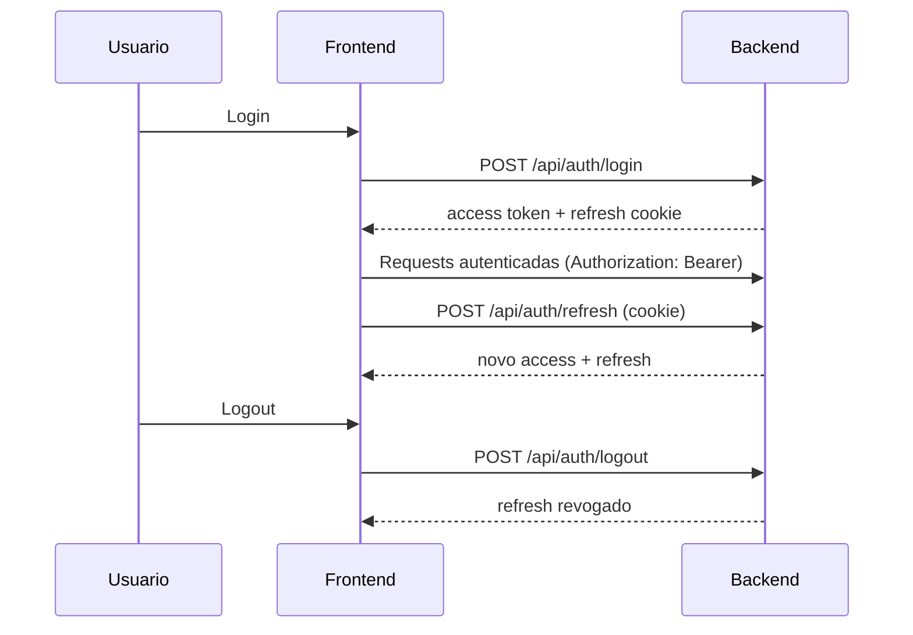
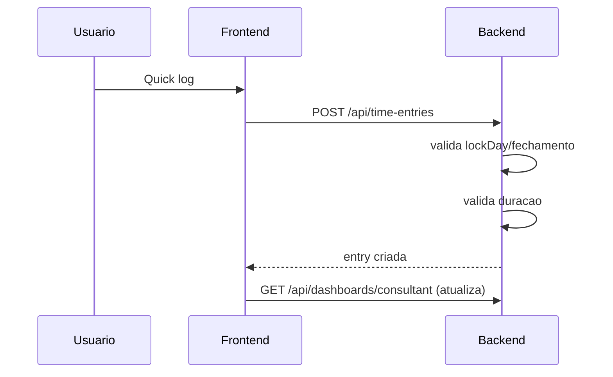
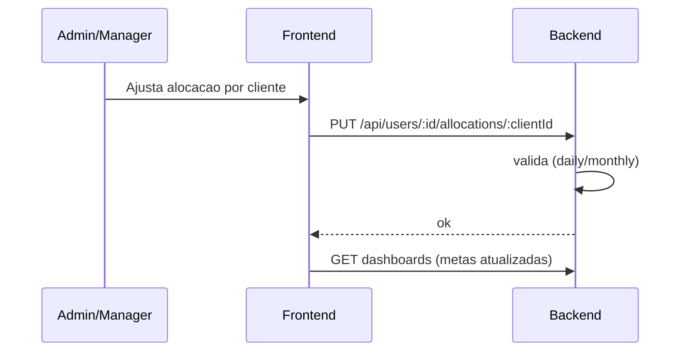
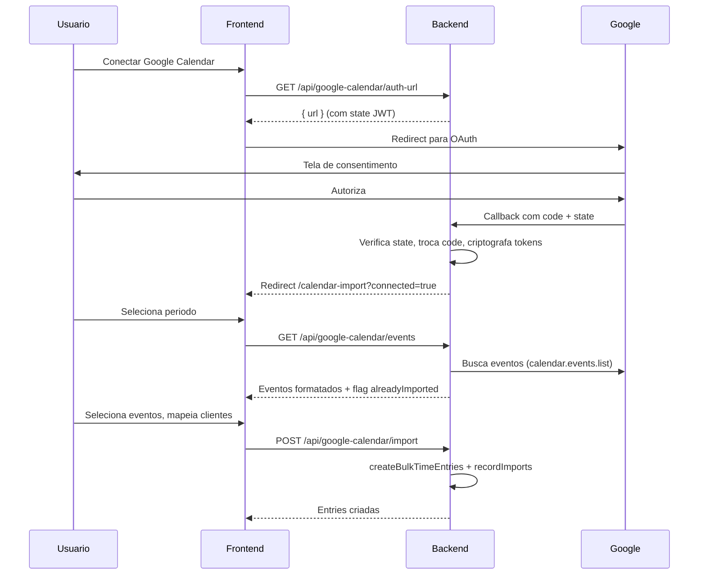

# Fluxos do Sistema

## Roles
- Admin (roleId=1)
- Manager (roleId=2)
- Consultant (roleId=3)

## Fluxo de autenticacao

## Fluxo de lancamento rapido (consultor/manager)

## Fluxo de lancamento em lote
- Usuario escolhe cliente e lista de dias
- Backend valida lockDay por cliente
- Backend cria entradas validas

## Fluxo de alocacao de horas (admin/manager)

## Fluxo de fechamento (lockDay)
- lockDay define dia limite
- A partir do dia seguinte: somente mes atual
- Backend bloqueia alteracoes de entries fora da janela
- UI remove botoes de edicao

## Fluxo de importacao Google Calendar

> Documentacao completa: [GOOGLE_CALENDAR.md](../integrations/google-calendar.md)

